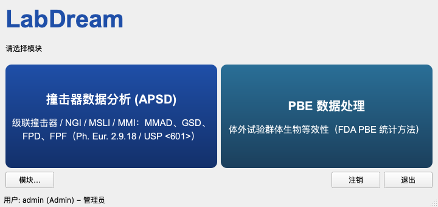
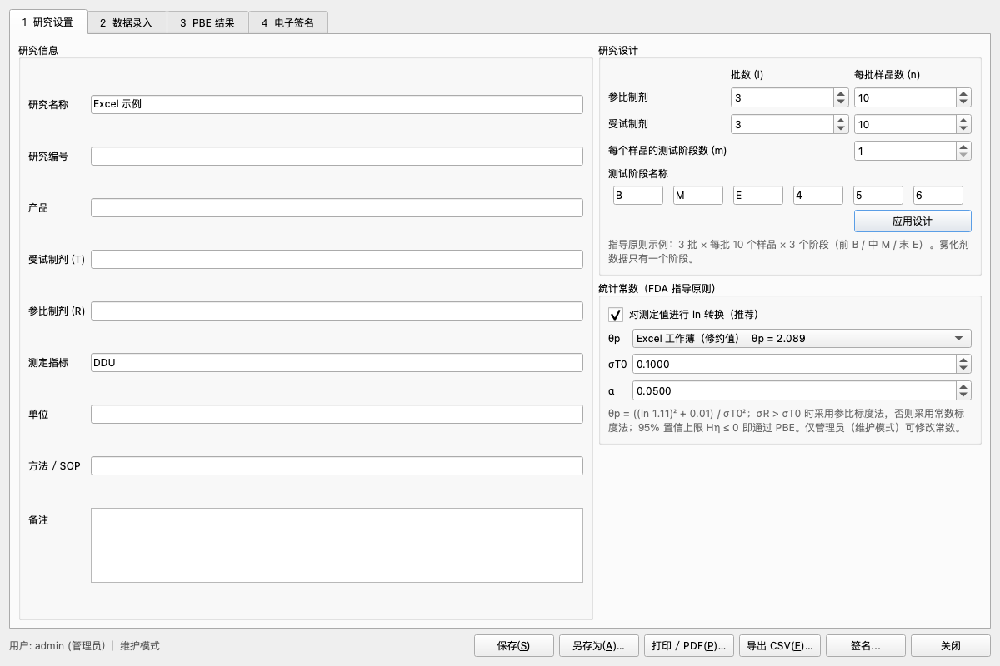
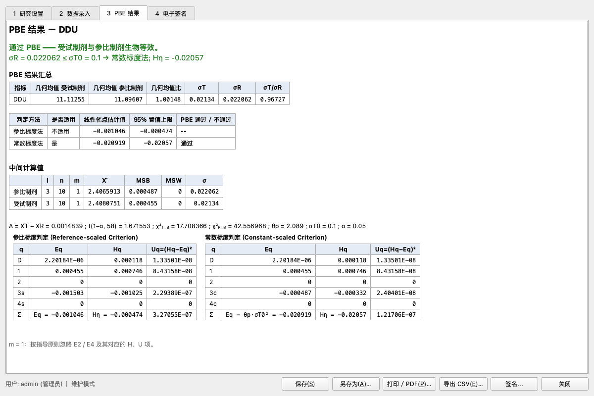

# LabDream Version 3.0 —— 撞击器数据分析 (APSD) + PBE 数据处理

一个软件、两个模块。登录后在模块选择界面选择：

| 模块 | 内容 |
|---|---|
| **撞击器数据分析 (APSD)** | 即 2.0 版全部功能（CI / NGI / MSLI / MMI，MMAD、GSD、FPD、FPF …），见下文 |
| **PBE 数据处理** | 体外试验群体生物等效性（PBE），按 FDA《布地奈德吸入混悬液指导原则》第 5 节 PBE 统计方法逐步计算，记录符合 21 CFR Part 11 |

两个模块共用同一套用户、角色、密码策略和审计追踪。管理员可在“模块…”中设定本机可用的模块
（只启用一个模块时登录后直接进入该模块）。



## PBE 数据处理模块

| 内容 | 说明 |
|---|---|
| 研究设计 | 参比 / 受试各自的批数 l、每批样品数 n；每个样品的测试阶段数 m = 1–6（如 MDI 的前 / 中 / 末，雾化剂 m = 1） |
| 数据录入 | 表格直接输入，或从 Excel 复制粘贴（Ctrl+V）；导入 CSV（指导原则表 1 格式：Batch, Container, Stage, Product, Value）；导入原 Excel 工作簿 “Original Data” 工作表 |
| 计算 | ln 转换（可关闭，用于已取对数的数据）→ MSB / MSW → σR、σT → Δ、ED…E4、HD…H4、UD…U4 → Eq、Uq、Hη；参比标度法与常数标度法同时计算，σR > σT0 采用参比标度法，否则采用常数标度法；Hη ≤ 0 判为通过 |
| 常数 | θp = ((ln 1.11)² + 0.01)/0.1² = 2.0891（指导原则精确值，默认）或 2.089（Excel 工作簿修约值）；σT0 = 0.1；α = 0.05；仅管理员可修改 |
| t / χ² 分位数 | 程序内置（不依赖第三方库），与 scipy 相对误差 < 1e-10 |
| 结果 | 指导原则表 2：几何均值、几何均值比、σT、σR、σT/σR、线性化点估计、95% 置信上限、通过 / 不通过；全部中间值 |
| 报告 | 打印预览 / PDF：结果汇总、中间值、结论、电子签名清单、记录标识（文件名、版本号、SHA-256）；个体数据（原始值、ln 值、均值） |
| 导出 | CSV（全部结果、中间值、原始数据和签名） |
| 文件 | `.pbe`（JSON + SHA-256 校验值） |




### 21 CFR Part 11 控制措施（PBE 模块）

| 条款 | 实现 |
|---|---|
| 11.10(a) 验证 | `tests/validate_pbe.py`：FDA 指导原则示例全部中间值、客户 Excel 工作簿全部单元格、t/χ² 分位数、文件完整性，共 93 项检查 |
| 11.10(b) 可读副本 | 打印 / PDF 报告、CSV 导出 |
| 11.10(c) 记录保护 | 文件含 SHA-256 校验值，在软件外被修改的文件拒绝打开并记入审计追踪；保存采用临时文件 + 原子替换 |
| 11.10(d) 访问控制 | 登录、三种角色、密码策略、5 次失败锁定 |
| 11.10(e) 审计追踪 | 新建 / 导入 / 打开 / 保存（必须填写修改原因，并记录每个改动值 旧值 → 新值）/ 签名 / 签名失败 / 打印 / PDF / 导出 / 关闭；只能追加，SHA-256 哈希链防篡改 |
| 11.10(f) 操作顺序 | 签名前必须先保存；执行人不能再审核 / 批准同一记录 |
| 11.10(g) 权限检查 | 分析员：录入、保存、“执行人”签名；审核员：只读、“审核人 / 批准人”签名；管理员：全部，含修改统计常数 |
| 11.50 签名含义 | 签名显示并打印：姓名、用户名、日期时间 (UTC)、含义（执行 / 审核 / 批准） |
| 11.70 签名与记录关联 | 签名保存记录内容的 SHA-256；签名后任何数据或设置变更都会使签名显示为“无效”，须重新签名 |
| 11.100 / 11.300 | 用户名唯一、只能停用不能删除（签名不会被重新分配）；密码 PBKDF2 加密存储；首次登录强制改密；管理员可重置密码 |
| 11.200(a) 签名组成 | 签名时重新输入用户名 + 密码；只能用本人账户；失败次数计入锁定 |

### 角色权限（PBE）

| 功能 | 管理员 | 分析员 | 审核员 |
|---|:-:|:-:|:-:|
| 打开、查看、打印、导出 | ✓ | ✓ | ✓ |
| 新建 / 导入 / 修改 / 保存 | ✓ | ✓ | |
| 修改 θp、σT0、α | ✓ | | |
| 签名：执行人 | ✓ | ✓ | |
| 签名：审核人 / 批准人 | ✓ | | ✓ |
| 模块设定、用户管理 | ✓ | | |

### PBE 验证

```bash
python tests/validate_pbe.py      # 93/93 checks passed
```

---

# 撞击器数据分析模块 (APSD)


吸入制剂撞击器（APSD）数据分析软件。根据原软件的功能、界面流程、使用说明书、
验证文档与验证数据重新实现（独立编写，未使用原软件代码、名称或图片）。

## 2.0 版新增内容

| 内容 | 说明 |
|---|---|
| ECD 随流速自动换算 | 在“用户设置”屏输入校准流速（如 15 / 30 / 60 L/min），各级截止粒径 ECD 立即按说明书第 11.1 章公式重新计算；采样流速相同的运行一并更新 |
| NGI 低流速 | 15–30 L/min 以 15 L/min 为基准（各级指数 0.2692 … 0.8598），30–100 L/min 以 60 L/min 为基准（指数 0.54 … 0.67） |
| 多语言 | English / 简体中文 / Español / Français，登录界面或“工具 → 语言”切换；界面、图表和打印报告均已翻译 |
| 用户管理 | 登录、三种角色（管理员 / 分析员 / 审核员）、密码策略（≥ 8 位，含字母和数字）、首次登录强制改密、连续 5 次失败自动锁定、管理员解锁 / 重置密码、用户只能停用不能删除 |
| 审计追踪 | 记录登录、注销、失败登录、用户变更、新建 / 打开 / 保存 / 关闭文件、流速变更、打印、导出、设置变更等；保存已有文件时须填写修改原因，并记录每个改动值（旧值 → 新值）；记录只能追加，SHA-256 哈希链可校验是否被篡改；可筛选、导出 CSV |
| 数据文件记录 | `.ldd` 文件保存创建人 / 创建时间 / 修改人 / 修改时间 / 版本号；报告页脚显示打印人 |

### 角色权限

| 功能 | 管理员 | 分析员 | 审核员 |
|---|:-:|:-:|:-:|
| 打开、查看数据 | ✓ | ✓ | ✓ |
| 输入 / 修改 / 保存数据、修改流速 | ✓ | ✓ | |
| 修改级名称、手动修改 ECD（维护模式） | ✓ | | |
| 打印、导出 | ✓ | ✓ | ✓ |
| 模板设置 | ✓ | | |
| 用户管理 | ✓ | | |
| 查看审计追踪 | ✓ | | ✓ |

首次启动时会要求创建第一个管理员账户。用户数据库和审计追踪保存在：
Windows `C:\ProgramData\LabDream\labdream.db`，macOS `~/Library/Application Support/LabDream/labdream.db`
（可用环境变量 `LABDREAM_DATA_DIR` 指定其他位置，例如网络共享目录）。

## 功能

| 功能 | 说明 |
|---|---|
| 设备 | 级联撞击器 CI（ACI）、多级液体撞击器 MSLI、Marple-Miller 撞击器 MMI、新一代撞击器 NGI |
| 三步向导 | Screen 1 用户设置（级名称、校准流速、ECD、样品信息）→ Screen 2 沉积数据（最多 12 次运行）→ Screen 3 结果汇总 |
| 计算 | 累积百分比（筛下）、对数-概率单位插值求 MMAD、FPD/FPF（按粒径或按级）、GSD、概率单位 4–6 回归 R²/斜率/截距 |
| 规则 | LOD（累积 <2% 或 >1% 的级少于 3 个）、NA（>50% 在滤膜/顶级或数据不足）、R² 低于设定值则 GSD = NA |
| 分组 | 5 个分组，按粒径范围或按级范围，给出 Particle Dose / Particle Fraction |
| 递送剂量均一性 | 75–125%、80–120%、85–115% 判定 |
| 报告 | EP 方法、USP 方法、图形汇总（每页 3 个运行）、表格汇总、分组结果；打印预览 / 保存 PDF |
| 导出 | CSV（与原软件导出格式相同的结构） |
| 文件 | 原生 `.ldd`（JSON）；可直接打开原软件的 `.CPL` 数据文件 |

## 运行

```bash
python3 -m venv .venv
.venv/bin/pip install -r requirements.txt
.venv/bin/python main.py
```

## 打包

- Windows：双击 `build_windows.bat`（需要 Windows 电脑），或上传到 GitHub 后由 GitHub Actions 自动生成
  `LabDream_Setup_3.0.exe` 安装包和 `LabDream_3.0_portable.zip` 免安装版。
- macOS：`./build_macos.sh`，生成 `dist/LabDream.app`。

## 验证

```bash
python3 tests/selftest.py --ui      # 引擎、ECD 换算、用户与审计、四种语言界面与报告、PBE 界面与签名流程
python3 tests/validate_pbe.py       # PBE：FDA 示例 + Excel 工作簿 + 分布函数 + 文件完整性
python3 tests/validate_against_reference.py "../Copley原装软件/CITDAS V3.10 Validation/Validation Document - Tables"
```

ECD 换算结果与原软件验证文档附录 A–D（CI、NGI 15/29/30/60/90、MSLI、MMI）逐值一致。

## 目录结构

```
main.py                    程序入口（登录 → 主菜单）
labdream/devices.py        设备定义、ECD 与流速换算
labdream/model.py          数据模型、修改比对
labdream/engine.py         计算引擎（MMAD/GSD/FPD/FPF/R²/分组/LOD/NA）
labdream/security.py       用户、密码、角色权限、审计追踪（SQLite，哈希链）
labdream/session.py        当前登录用户
labdream/i18n.py           语言切换
labdream/translations.py   中文 / 西班牙语 / 法语翻译表
labdream/cpl.py            原 .CPL 数据文件导入
labdream/fileio.py         .ldd 保存/读取、CSV 导出
labdream/charts.py         概率图、沉积柱状图、累积分布图
labdream/reports.py        EP/USP/图形/表格/分组 报告
labdream/pbe.py            PBE 数据模型、计算引擎、导入导出
labdream/stats.py          t / χ² 分布函数及其反函数
labdream/pbe_report.py     PBE 报告
labdream/ui/home.py        模块选择
labdream/ui/pbe_window.py  PBE 主菜单、研究编辑器、电子签名
labdream/ui/               界面（登录、主菜单、三步向导、用户管理、审计追踪、对话框）
tests/                     自测、界面测试、与原软件验证数据的对比
```
